# User handbook

How to use the ITC Maintenance System: who each screen is for, what to do on
it, which fields an action needs, and what happens next. Every screen is
shown twice, at desktop (1440 px) and phone (390 px), and every capture uses
the deterministic demo dataset, so the names and counts in this handbook match
what the demo accounts see.

The screenshots live in `shots/`. Regenerate them with
`python tools/shots.py` (see section 11). `shots/` holds build artifacts and is
excluded from version control, so run the capture command before reading this
handbook from a fresh clone.

## 1. Open the system and sign in

### Run it locally

```
python server/app.py
```

Then open <http://127.0.0.1:8787/>. On Windows, double-click `start.bat`.
The backend serves the pages and the API on one origin, so sign-in, the
dataset and every action round-trip through the server, and the permission map
is enforced on the trusted layer.

For a static host without the API, the pages still work: `js/api.js` falls
back to the browser engine and the bundled seed dataset.

### Sign in

Sign-in is UPMail Google Workspace, restricted to `@upcebu.edu.ph`. An
account with no provisioned role sees "Access not granted" and must ask the IT
Office for access.

The sign-in page always lists four development accounts, labelled "Demo
only". Choosing one scopes the whole workspace to that role.

| Role | Person | UPMail | Office |
|---|---|---|---|
| Office Requester | A. Delos Reyes | a.delosreyes@upcebu.edu.ph | Records Office |
| IT Technician | J. Tan | j.tan@upcebu.edu.ph | IT Office |
| IT Coordinator | K. Ramos | k.ramos@upcebu.edu.ph | IT Office |
| System Administrator | M. Reyes | m.reyes@upcebu.edu.ph | Office of the Director |

The role decides which pages exist for you. The address bar names the role:
`or-` for Office Requester, `itc-` for IT Technician, `ic-` for IT
Coordinator, `mgmt-` for System Administrator. The prefix never grants
access. Opening another lane's prefix redirects you to your own equivalent
page.

### Appearance

Light is the default theme; a dark theme is available from the theme switch.
Every screen has a phone layout, and the navigation moves to a bottom tab bar
on small screens.

## 2. The four lanes

| Lane | Main job | Data scope |
|---|---|---|
| Office Requester | Raises and follows up requests, answers questions, confirms results | The offices the person belongs to, plus the requests they raised |
| IT Technician | Diagnoses, repairs, tests, and executes maintenance checklists | Tickets and maintenance jobs assigned to them, plus read-only office and asset history for those offices |
| IT Coordinator | Reviews, assesses, assigns, schedules, monitors and closes | All offices |
| System Administrator | Users, roles, offices, assets, reference data and the audit trail | Administration only, with no ticket, job or report surface |

The System Administrator does not operate the workflow. It administers the
data the workflow depends on and reads the audit trail. The ticket, job,
schedule, report and export routes are refused for that lane.

## 3. The eight status labels

Use these labels exactly:

Submitted, Needs Information, Assigned, In Progress, On Hold, Resolved,
Closed, Cancelled.

The status always names the next owner, so a reader never has to guess who
moves the record next.

| Status | Who acts next | What they do |
|---|---|---|
| Submitted | IT Coordinator | Review the request, ask for missing details, or assess and assign it |
| Needs Information | Office Requester | Supply the missing information on the same ticket |
| Assigned | IT Technician | Coordinate the schedule and start the work |
| In Progress | IT Technician | Diagnose, repair, test, or place the work on hold |
| On Hold | IT Coordinator | Follow up the dependency and return the work to the technician |
| Resolved | Office Requester | Confirm the result, or reject it with feedback |
| Closed | Nobody | The record is retained and becomes part of the service history |
| Cancelled | Nobody | The record is retained with its reason and history |

A maintenance job adds four steps with the same rule:

| Job step | Who acts next |
|---|---|
| Generated, not yet assigned | IT Coordinator |
| Availability unconfirmed or office unavailable | Office Requester |
| Checklist in progress | IT Technician |
| Awaiting confirmation | Office Requester |

## 4. Office Requester

You raise requests for your office, answer questions, keep an eye on progress,
and confirm the result. You see only the offices you belong to, plus the
requests you raised yourself. Maintenance visits follow the office alone.

Your screens:

| Screen | Address | What it is for |
|---|---|---|
| Dashboard | `or-dashboard.html` | Your queue, status counts, quick actions, due maintenance and recent history |
| New Request | `or-request.html` | Submit a request, reply to a question, request withdrawal |
| Service Tickets | `or-tickets.html` | Filter, sort and export the records you may see |
| Service Record | `or-ticket.html` | One ticket: status, history, replies, attachments, withdrawal |
| Confirmation and Closure | `or-confirm.html` | Office availability, accept or reject, recurrence, visit confirmation |
| Office Register | `or-register.html` | Read-only list of corrective tickets and preventive jobs |
| Maintenance Visits | `or-visits.html` | Read-only view of the visits planned for your office |
| Reports | `or-reports.html` | Office metrics and the eight report types with CSV export |
| Notifications | `or-notifications.html` | Your inbox, read state and mark all read |
| Profile | `or-profile.html` | Contact details, password panel, appearance and session |
| Workflow Guide | `or-flow.html` | The documented process for all four lanes |
| Roles and Access | `or-roles.html` | What each role may do, and the route permission reference |

### 4.1 Raise a request

1. Open New Request from the sidebar, the dashboard quick action, or
   `or-request.html`.
2. Your office and your name are fixed to your account. The coordinator is the
   only role that picks a different office or requester.
3. Choose a category, describe the issue, and optionally pick an asset. The
   asset register offers suggestions and the field stays free to type.
4. The date reported and the source are recorded. Your own submission is
   recorded as Online portal.
5. Attach evidence if it helps: jpg, png, webp, pdf, docx, xlsx, csv or txt,
   at most 10 MB per file and 10 files per upload.
6. Submit. The system issues the ticket number, sets the status to Submitted
   and notifies the coordinator.

Required data: office, requester, category, issue, date reported, source. The
priority starts at Medium and the coordinator sets the final priority during
assessment. A double submission is harmless because the request carries an
idempotency key.

What happens next: the ticket appears in the coordinator's Review and Assign
queue. You can follow it in Service Tickets.

### 4.2 Answer a request for information

When the coordinator needs more detail, the ticket moves to Needs Information.
Open the ticket from your queue, read the question, and send the information
on the same record. The ticket returns to Submitted. No second ticket is
created.

### 4.3 Track a request and reply

Service Tickets lists every record you may see. Use the search, the filters and
the column picker to narrow the list, then open a row. The record shows the
status, the history, the conversation and the attachments. A reply you write
is public and reaches the IT lanes. Internal notes written by IT staff are
never shown to an office session.

### 4.4 Ask to withdraw a request

Open the active request and choose Request withdrawal. Record the reason. The
status does not move at this step; the IT Coordinator records the cancellation
reason, because that step belongs to their lane. The request and its history
are retained.

### 4.5 Confirm or reject the fix

When the technician records a passed test, the ticket moves to Resolved and
the decision belongs to your office alone. The coordinator cannot answer for
you.

1. Open Confirmation and Closure.
2. Accept: record the confirming person. The ticket closes in that one step.
3. Reject: record the office feedback. The ticket returns to In Progress for
   the assigned technician.
4. No response: the ticket stays Resolved and the system sends a follow-up
   reminder. It is not closed silently.

The same screen lists the confirmation queue and the closed records that can
seed a recurrence.

### 4.6 Maintenance visits

Confirm whether your office is available, agree a new date when needed, and
confirm the visit when the checklist is complete. If the office does not
answer, the job stays pending and the system reminds the office. A rejection
returns the visit to verification.

### 4.7 A recurring problem

Open a Closed ticket and choose Issue recurs, new linked ticket. The new
ticket starts at Submitted and follows the same workflow, and the previous
record is flagged as recurring. Only a Closed ticket can be the source.

### 4.8 Reports and the register

Reports shows the metrics and the eight report types for your office, each
with CSV export. Because the office lane is scoped to one office, the
cross-office comparison belongs to the IT lanes. The Office Register is the
read-only list of corrective tickets and preventive jobs your office may see.
Maintenance Visits is the read-only visit list.

### Your screens

#### Dashboard

Your landing screen. It holds the queue that needs your action, the eight
status labels as links, quick actions, due maintenance and the recent history.
The office lane does not draw the ticket activity chart; the status breakdown
takes the full width instead.

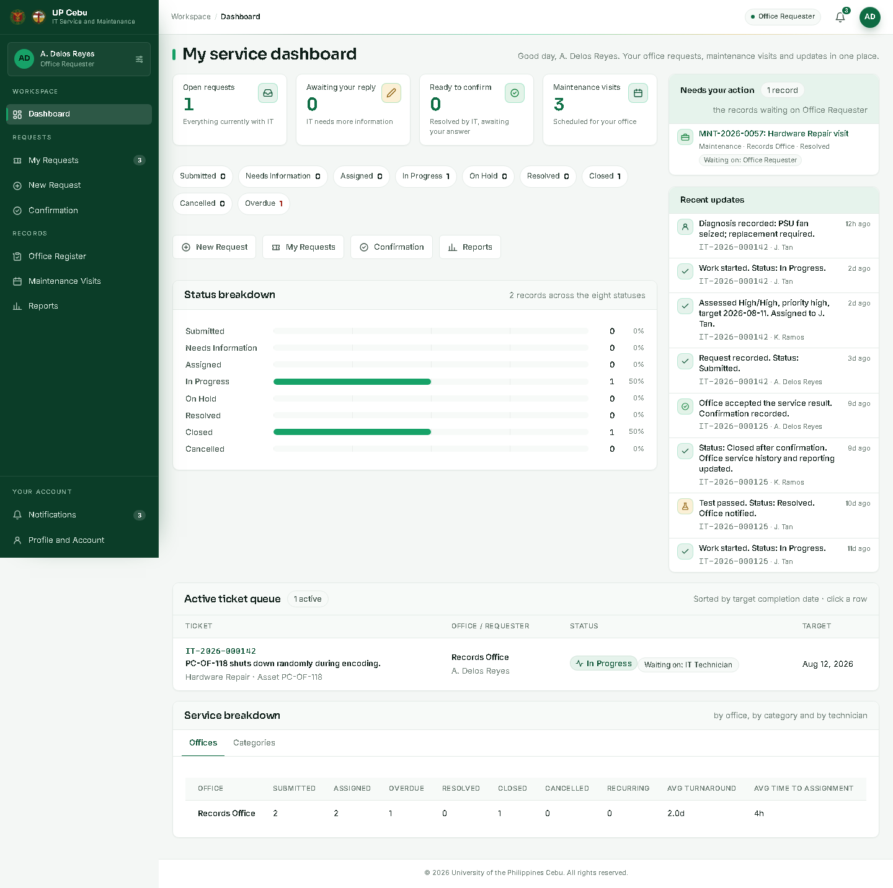

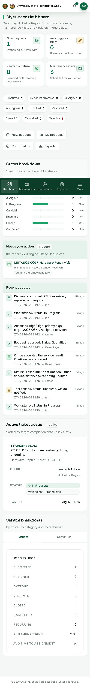

#### New Request

The intake form. It also carries your recent requests, the reply control for a
Needs Information ticket, and the withdrawal control.

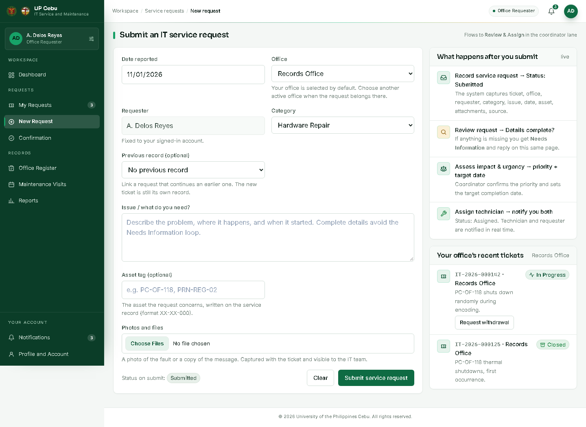

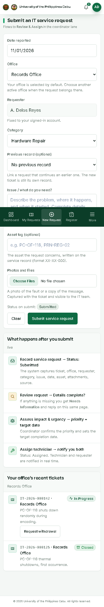

#### Service Tickets

The register for your lane: search, filters, sortable columns, the column
picker, pagination and CSV export. Export mirrors the columns you were shown.

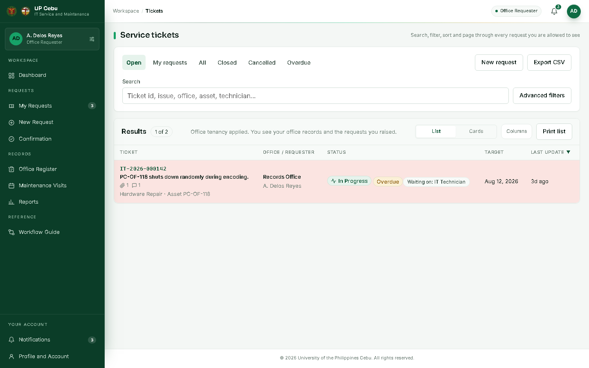

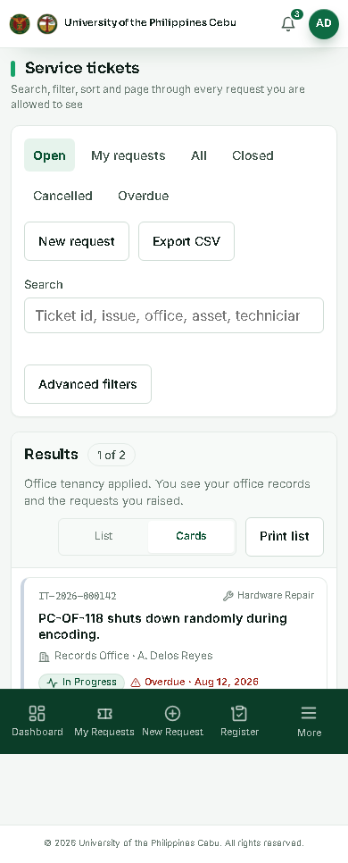

#### Service Record

One ticket in full: the five-step track, status and merged history, the reply
composer, attachments, impact and urgency, diagnosis, costs, testing and the
next action.

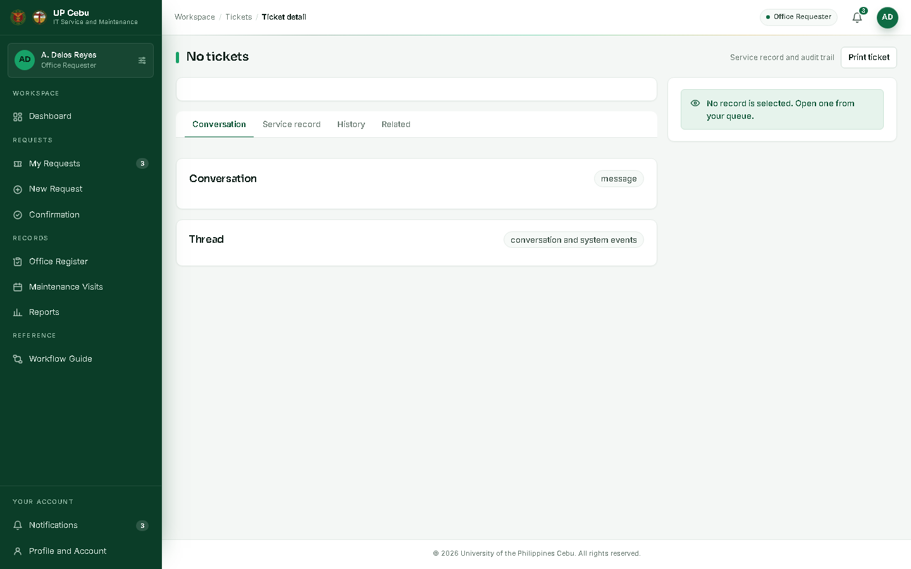

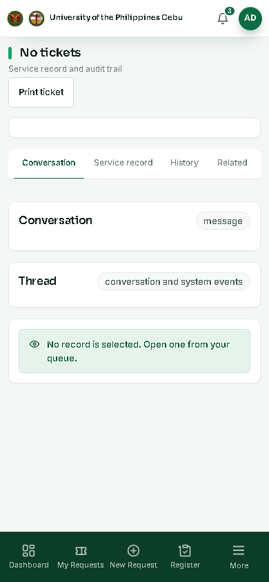

#### Confirmation and Closure

The office decision queue, availability answers, reminders, recurrence and the
maintenance visit confirmation.

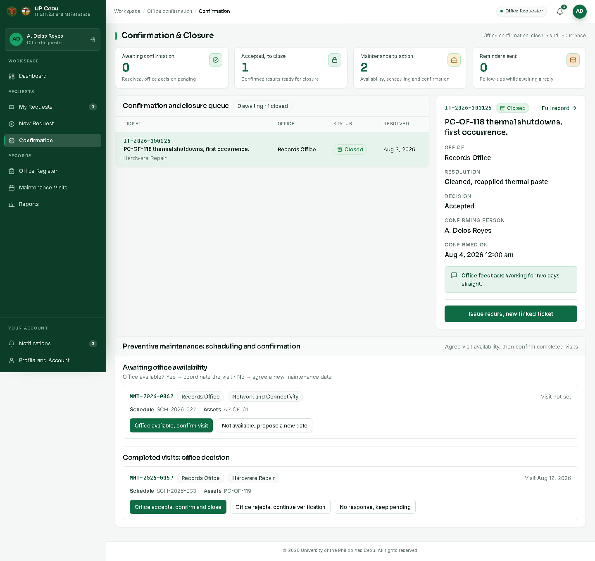

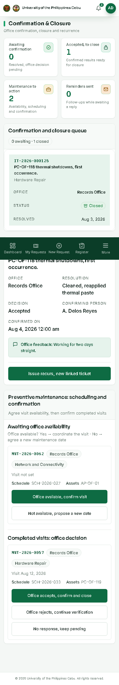

#### Office Register

The read-only register of corrective tickets and preventive jobs for the
office.

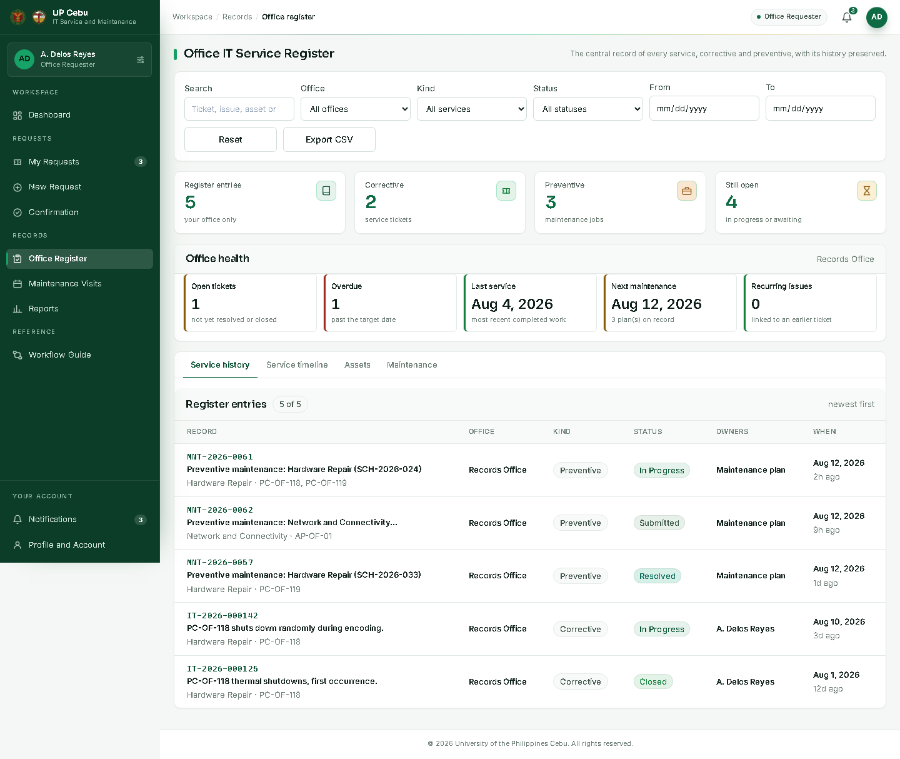

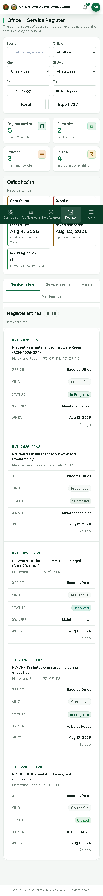

#### Maintenance Visits

The read-only list of visits planned for the office, with dates, technicians
and status.

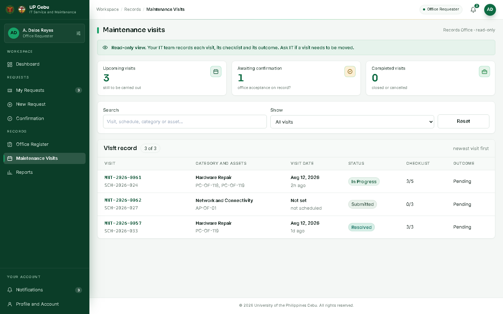

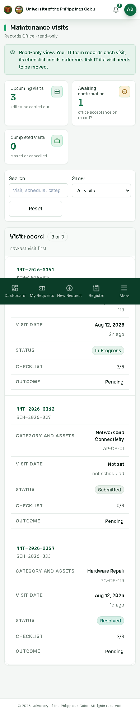

#### Reports

The office metrics and the eight-report catalogue, with filters and CSV
export.

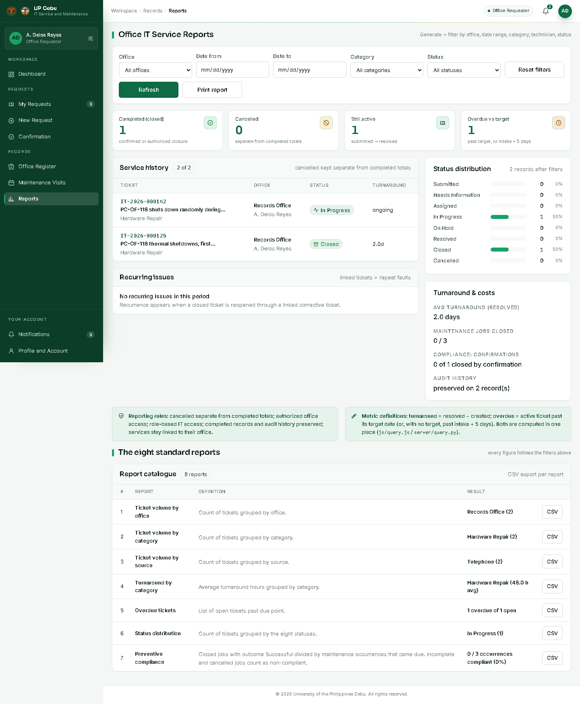

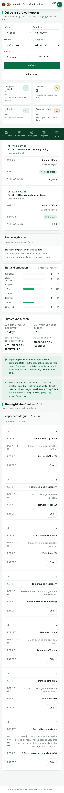

#### Notifications

The full inbox. The bell is the two-line preview; this page holds every
notification addressed to you and the per-user read state.

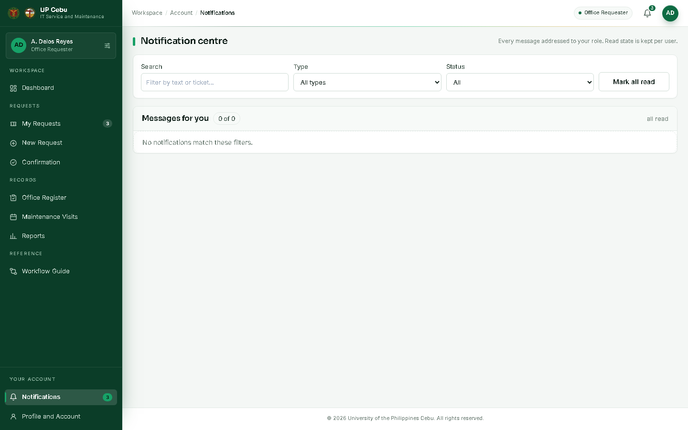

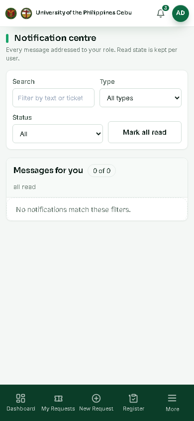

#### Profile

Contact details, the password panel, and appearance and session preferences.

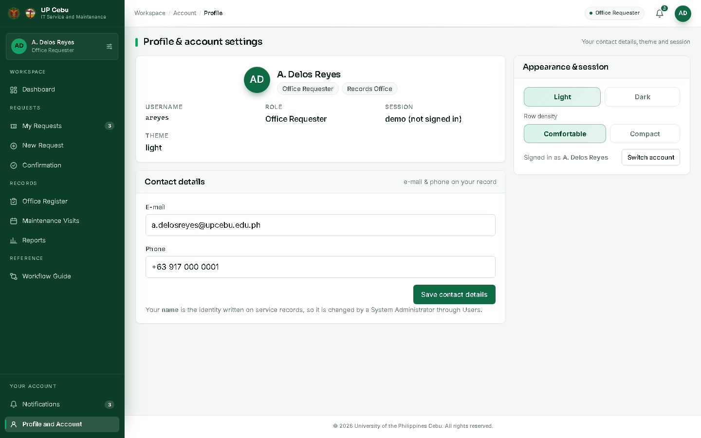

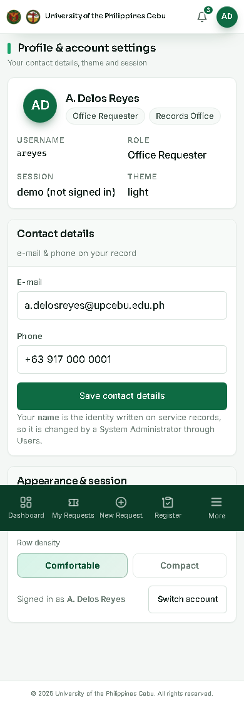

#### Workflow Guide

The swimlane diagram of the documented process, with the coverage proof for
every step.


#### Roles and Access

The four roles, what each may do, and the route permission reference.

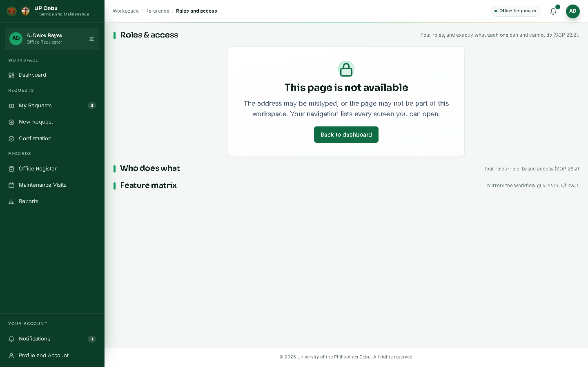


## 5. IT Technician

You work the tickets and maintenance jobs assigned to you. You coordinate the
visit, diagnose, repair, test, and document what you did. You cannot act on a
record that is not assigned to you; the backend refuses it even if the call is
made directly.

Your screens:

| Screen | Address | What it is for |
|---|---|---|
| Dashboard | `itc-dashboard.html` | Your workload, queues, due maintenance and recent activity |
| My Work | `itc-technician.html` | The workbench for the ticket you are servicing |
| Service Tickets | `itc-tickets.html` | Filter, sort and export your records |
| Service Record | `itc-ticket.html` | One ticket in full, with the conversation and evidence |
| Maintenance | `itc-maintenance.html` | Schedules, generated jobs and checklist execution |
| Office Register | `itc-register.html` | Read-only register of tickets and jobs |
| Reports | `itc-reports.html` | Workload and service metrics, CSV export |
| Notifications | `itc-notifications.html` | Your inbox |
| Profile | `itc-profile.html` | Contact details and preferences |
| Workflow Guide | `itc-flow.html` | The documented process |
| Roles and Access | `itc-roles.html` | The role and route reference |

### 5.1 Start the work

1. Open My Work or the assigned ticket.
2. Coordinate the schedule with the office: record a date or a coordination
   note. This is required before the work starts.
3. If the category needs approval, the coordinator records the sign-off.
4. Choose Start work. The status moves to In Progress.

### 5.2 Diagnose and record the repair

Record the findings, then the repair: the actions taken, the parts and
materials, the cost, the labour, the dates and the evidence. Every entry is
appended to the service record, so the office and the coordinator can read
what happened without asking.

### 5.3 Place the work on hold

When a dependency blocks the work, record the dependency, the reason, the
responsible person and the next action. The status moves to On Hold and both
the office and the coordinator are notified. The coordinator follows up and
resolves the dependency, which returns the ticket to you.

### 5.4 Record the test

A passed test sets the ticket to Resolved and asks the office to confirm. A
failed test does not change the status: the ticket stays In Progress and the
failure is recorded, so the work returns to diagnosis.

### 5.5 Maintenance checklists

Open Maintenance for the assigned job. Record each checklist item with its
result and findings, answer the additional fault question, and record the
outcome. The completed visit moves to Resolved and asks the office to confirm.
A Successful outcome is written by the system only when the checklist is
complete; Incomplete and Cancelled outcomes belong to the IT Coordinator.

If you answer the additional fault question with yes, the system creates a
linked corrective ticket that starts at Submitted. The job keeps its own
documentation.

### 5.6 Comments and notes

You may post a public reply or an internal note on a record assigned to you.
Internal notes never reach an office session. A ticket that is not assigned
to you refuses the comment.

### Your screens

#### Dashboard

Your workload at a glance: the queue that needs your action, workload and
status counts, maintenance due, and recent activity.

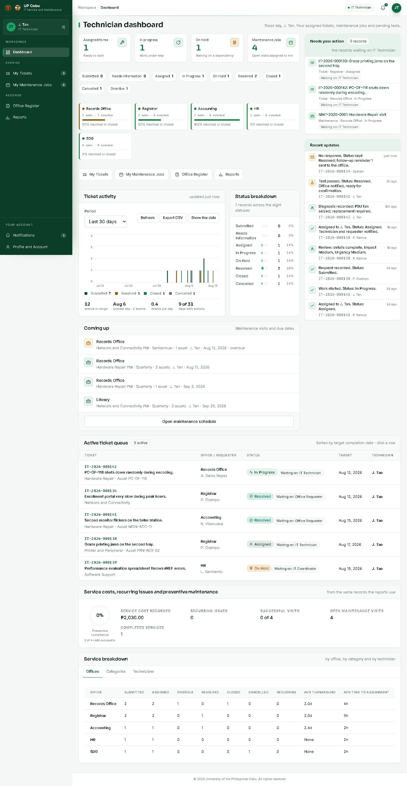

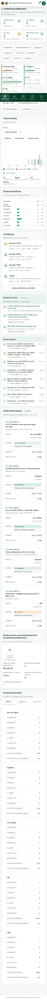

#### My Work

The workbench for the ticket you are servicing: the schedule, diagnosis,
repair actions, test result, dependency and the next step.

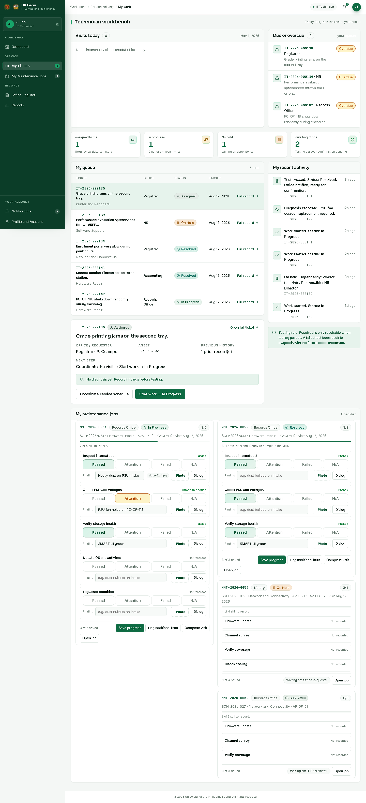

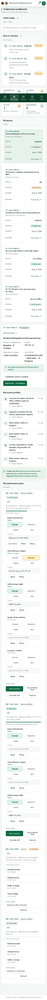

#### Service Tickets

The register for your records, with the same filters, sorting, column picker
and export as the other lanes.

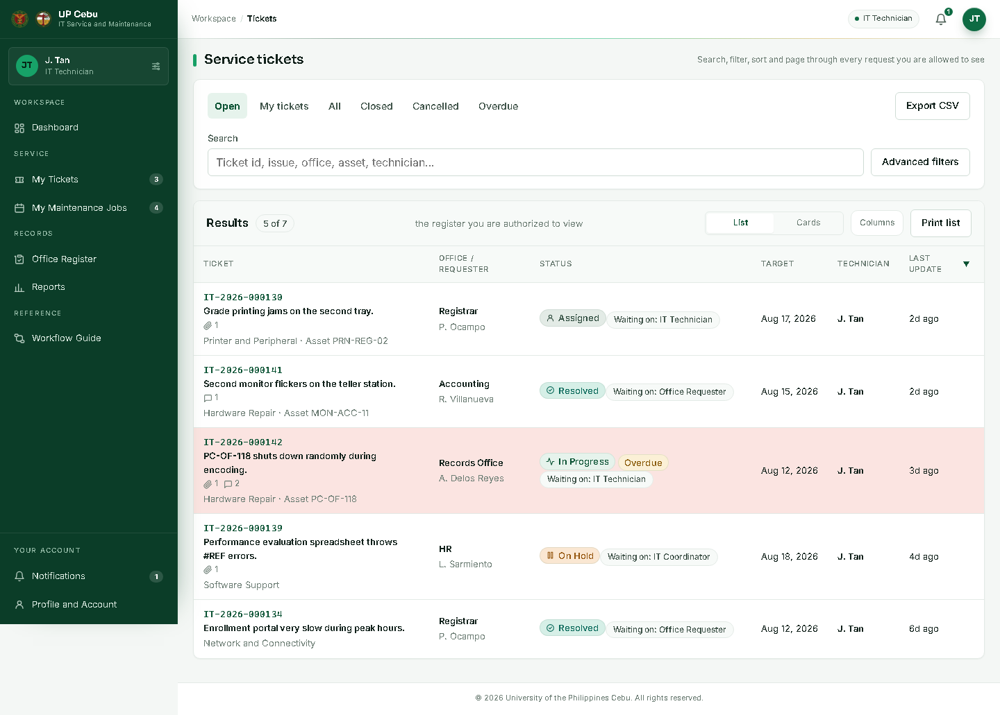

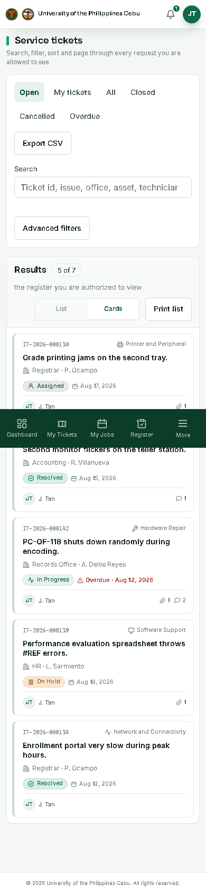

#### Service Record

One ticket in full, including the internal note composer and the evidence.

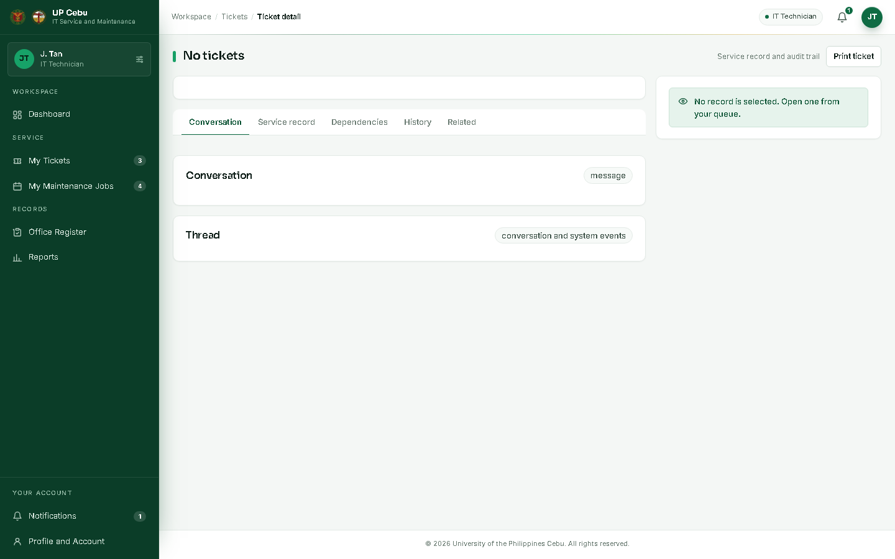

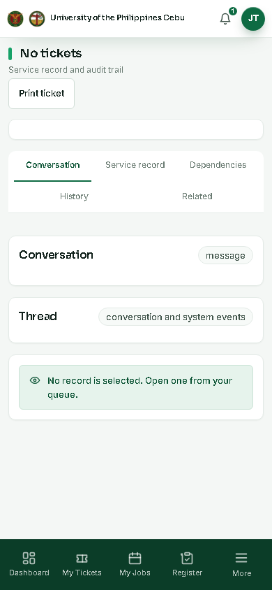

#### Maintenance

Schedules, generated jobs, checklist execution, next due dates and the
additional fault hand-off.

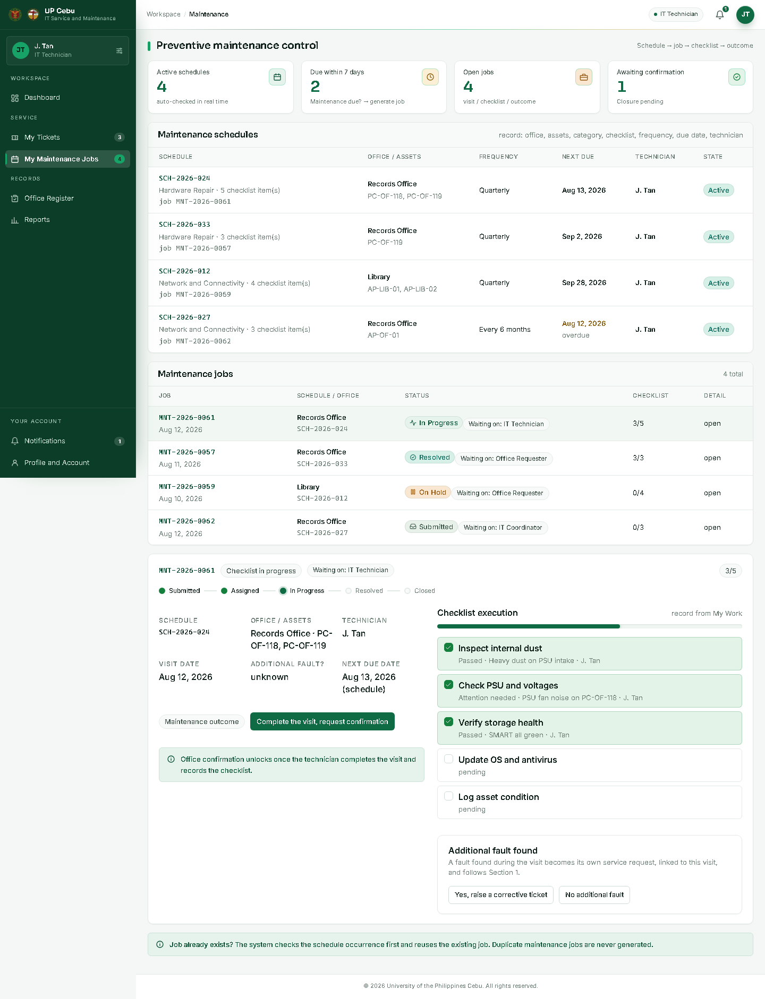

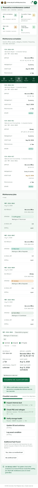

#### Office Register

The read-only register of corrective tickets and preventive jobs for the
offices you serve.

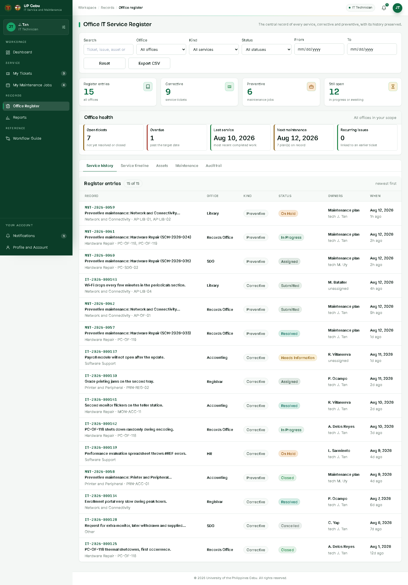

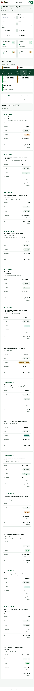

#### Reports

Workload and service metrics with the eight report types and CSV export.

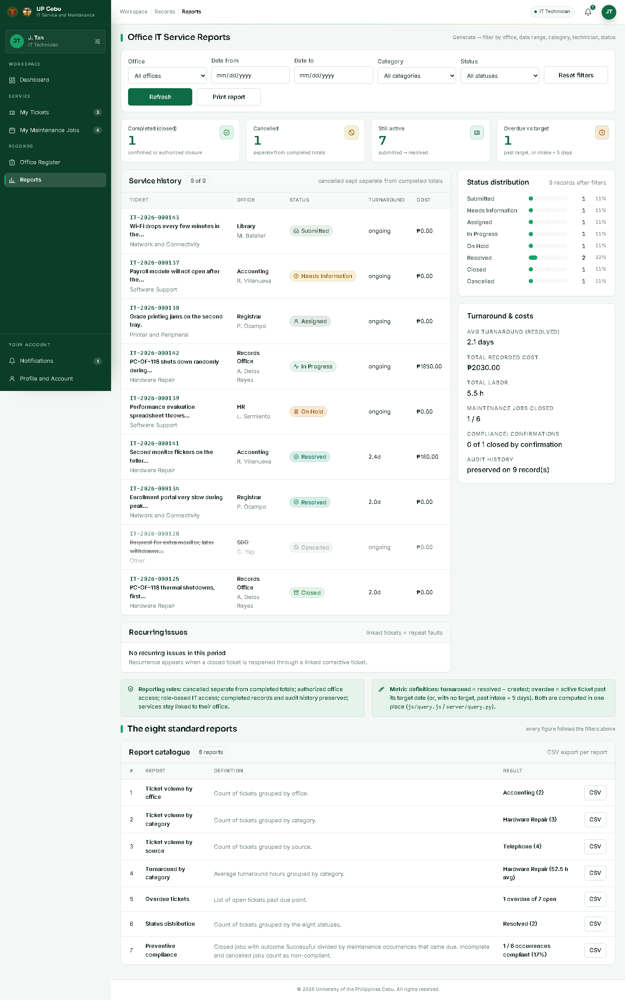

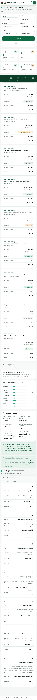

#### Notifications

Your inbox, with the read state per user.

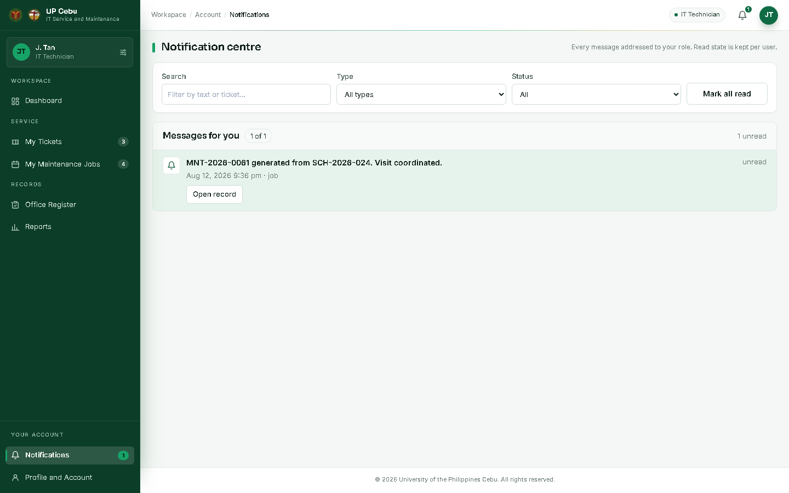

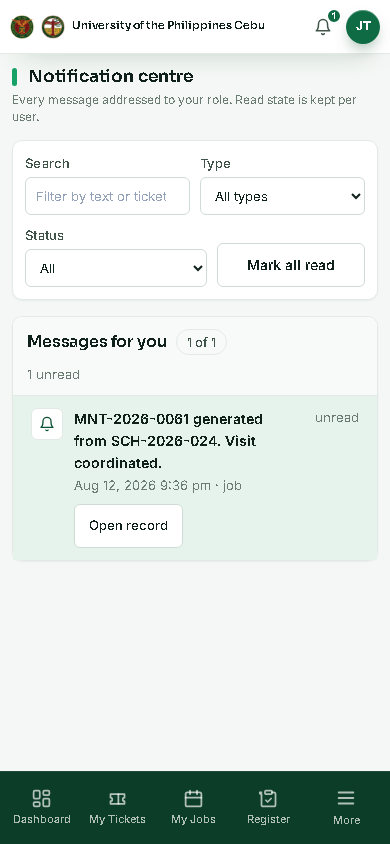

#### Profile

Contact details and preferences.

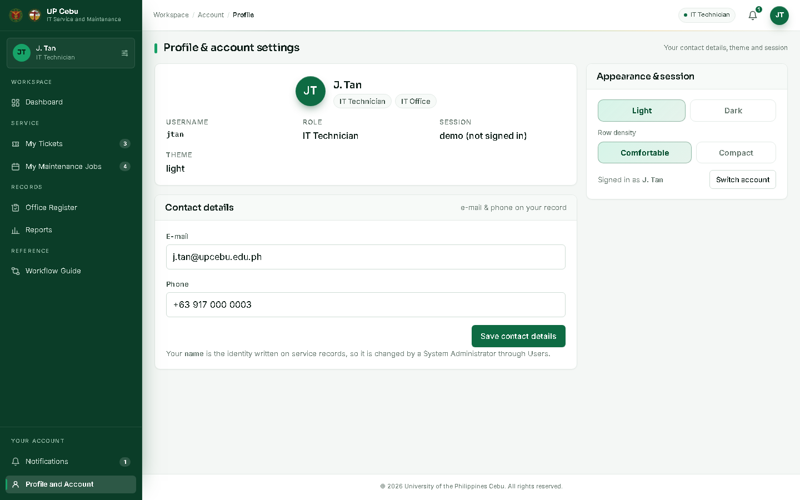

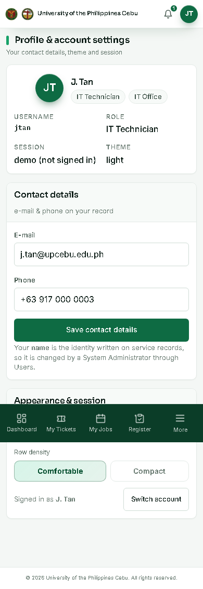

#### Workflow Guide

The documented process for all four lanes.


#### Roles and Access

The role and route reference.

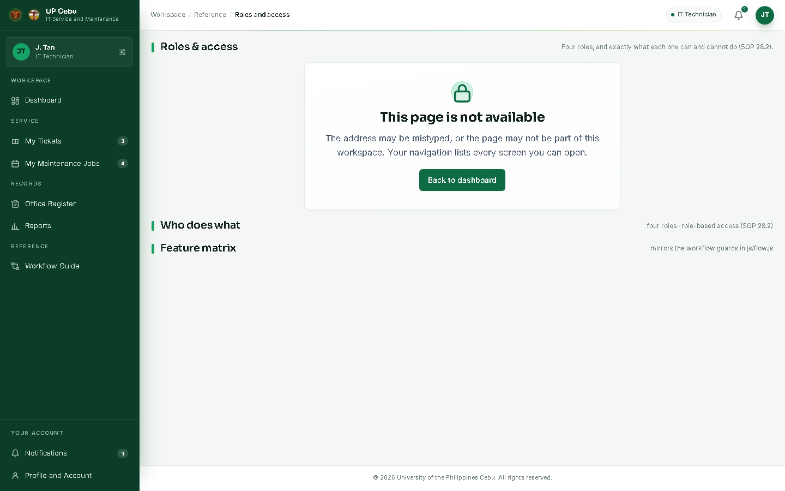

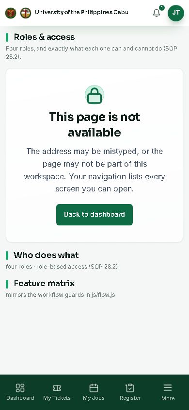

## 6. IT Coordinator

You own the interview between the office and the technician: review, assess,
assign, schedule, monitor and close. You see all offices.

Your screens:

| Screen | Address | What it is for |
|---|---|---|
| Dashboard | `ic-dashboard.html` | Every office, the review queue, holds and due work |
| Review and Assign | `ic-review.html` | Ask for information, assess, prioritise, assign |
| New Request | `ic-request.html` | Raise a request on behalf of an office |
| Service Tickets | `ic-tickets.html` | Filter, sort, bulk assign and export every record |
| Service Record | `ic-ticket.html` | One ticket in full |
| Maintenance | `ic-maintenance.html` | Schedules, generated jobs, pause and resume |
| Confirmation and Closure | `ic-confirm.html` | Reminders, authorized closure, recurrence, visit closure |
| Office Register | `ic-register.html` | The central register of every ticket and job |
| Reports | `ic-reports.html` | Cross-office metrics and the eight reports |
| Notifications | `ic-notifications.html` | Your inbox |
| Profile | `ic-profile.html` | Contact details and preferences |
| Workflow Guide | `ic-flow.html` | The documented process |
| Roles and Access | `ic-roles.html` | The role and route reference |

### 6.1 Review and assign

1. Open Review and Assign and pick a Submitted request.
2. If it is incomplete, choose Request information. The status moves to Needs
   Information and the office is asked. The reply returns the same ticket to
   Submitted.
3. If it is complete, assess it: record impact, urgency, priority and the
   target completion date. The priority is derived from the configured matrix.
4. Assign a technician. The status moves to Assigned and both the technician
   and the requester are notified.
5. Reassign when ownership has to move. The status stays and the change is
   written to the audit trail.

For a category that needs approval, record the coordinator sign-off before the
work starts.

You may also raise a request on behalf of an office from New Request. In that
case you choose the office and the requester, and the source is required.

### 6.2 Monitor the queue

The dashboard and Service Tickets show what is waiting, what is on hold and
what is due. The on-hold list carries the dependency owner and the next
action, so a follow-up is never guesswork.

### 6.3 Chase a dependency

1. Follow up: record the update. The ticket stays On Hold and the follow-up
   date moves on.
2. Resolve the dependency: record the outcome. The ticket returns to In
   Progress and goes back to the assigned technician.
3. Cancel from dependency when the work cannot continue: record the reason,
   notify the requester, and keep the record and its history.

### 6.4 Confirmation and closure

When a ticket is Resolved, the office decides. You cannot accept or reject on
their behalf. If the office does not answer, send a reminder; the status stays
Resolved.

* Authorized closure: record the reason. The closure mode, the authoriser and
  the date are written to the audit trail. The office confirmation mode is not
  available to you.
* Recurrence: open a Closed ticket and create the linked follow-up ticket.

### 6.5 Maintenance schedules

1. Create a schedule with the office, the assets, the category, the checklist,
   the frequency, the due date and the technician.
2. Update the plan when the cadence or the technician changes. The generated
   job inherits the technician from the plan.
3. Pause or resume the plan. A paused plan generates no new jobs.
4. Run the schedule check when you need it by hand. It is idempotent: the same
   occurrence is never generated twice.

Close a visit with a reason when it has to be closed by the coordinator. The
system writes Successful only when the checklist is complete; otherwise the
outcome is Incomplete. The technician records the completed visit and the
office confirms it.

### 6.6 Cancel a request

Record the cancellation reason. Every status except Closed and Cancelled may
be cancelled, the requester is notified, and the record and its history are
retained.

### 6.7 Reports and the register

The Office Register is the central list of every corrective ticket and
preventive job. Reports carries the cross-office metrics, the SLA and overdue
definitions, and the eight reports with CSV export. Exports carry the same
scope as the screen.

### Your screens

#### Dashboard

Every office at a glance: the review queue, holds, due maintenance, workload
and activity.

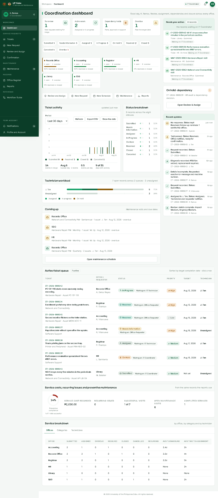


#### Review and Assign

The coordinator workbench: request information, assess, prioritise and assign.

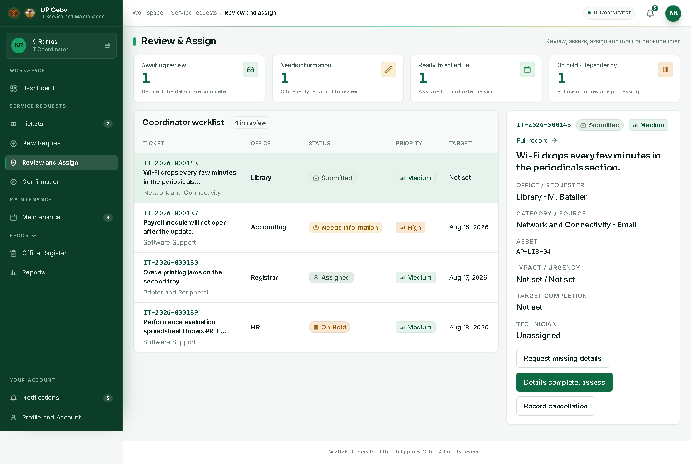

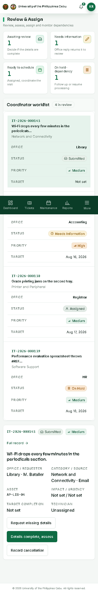

#### New Request

Raise a request on behalf of an office. Office, requester and source are
chosen here.

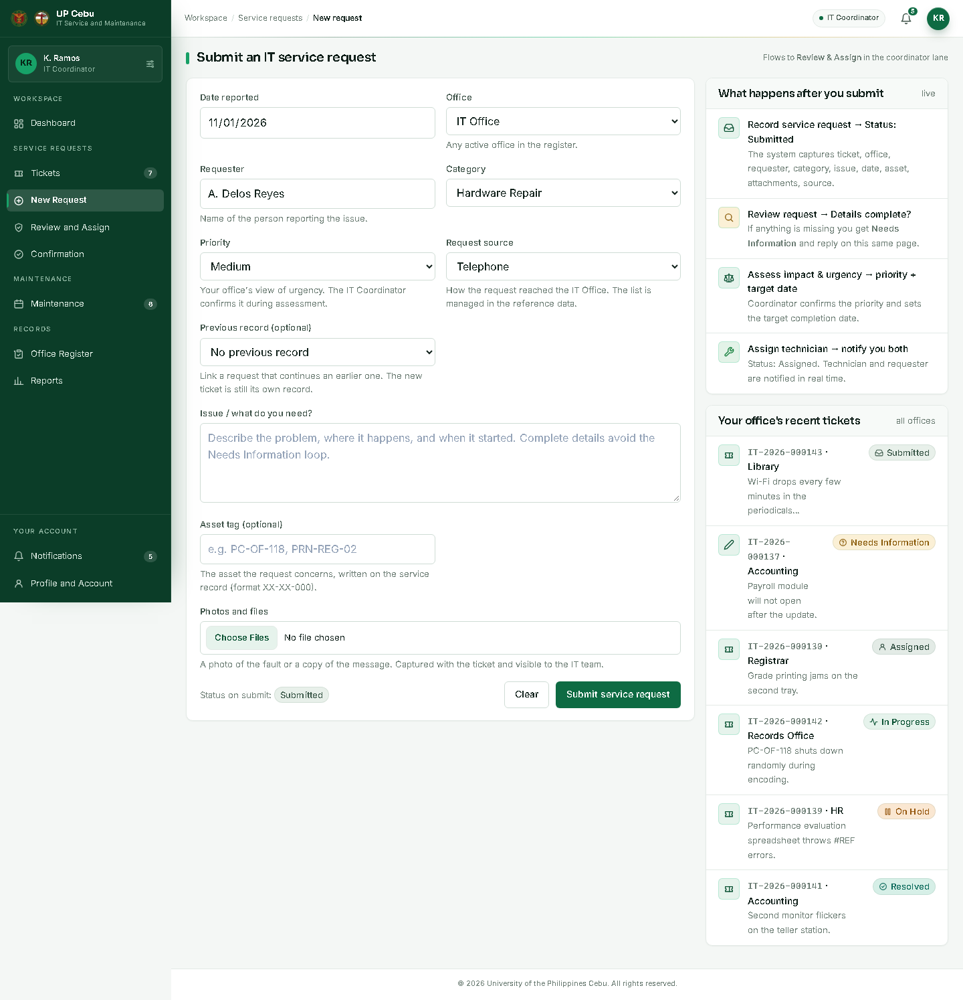

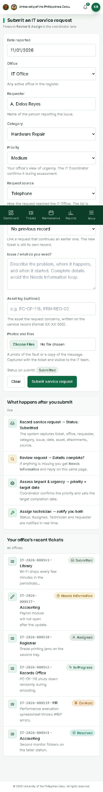

#### Service Tickets

Every record, with filters, sorting, column picker, bulk assign and CSV
export.

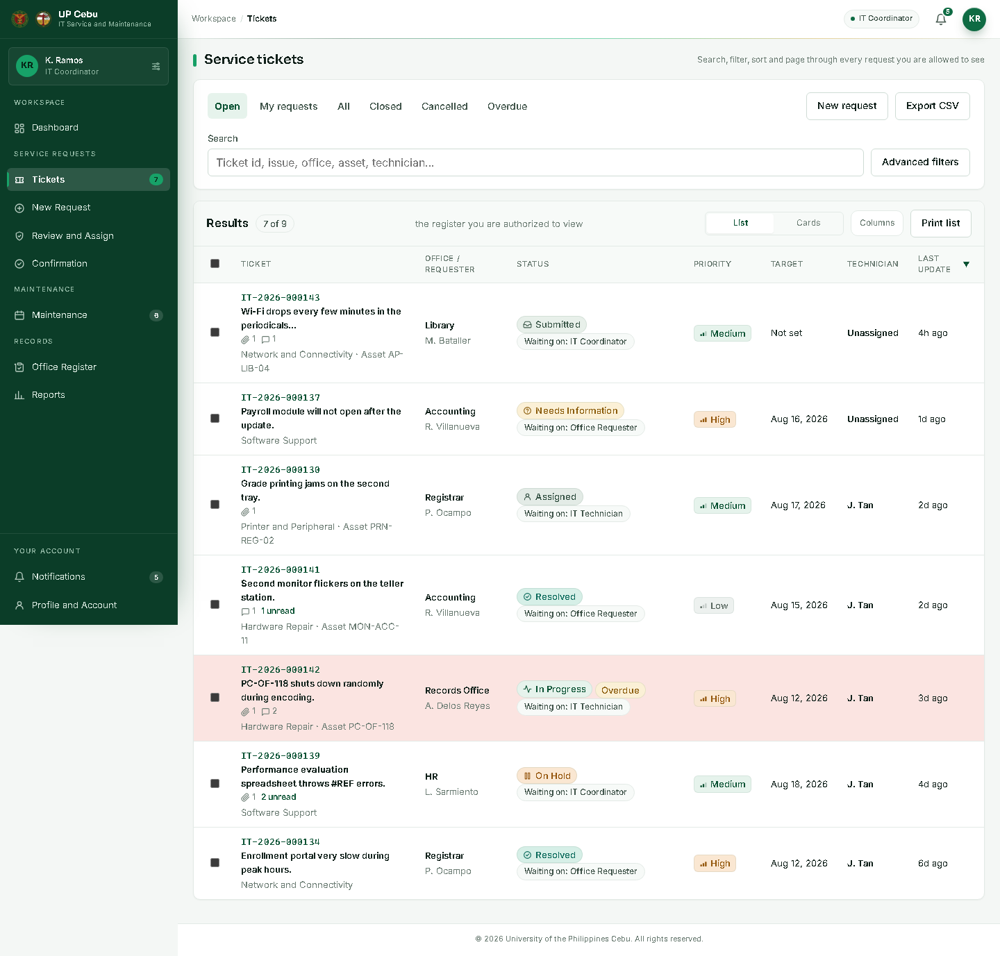

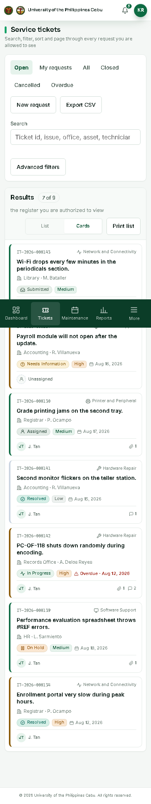

#### Service Record

One ticket in full, with the conversation, evidence and next step.

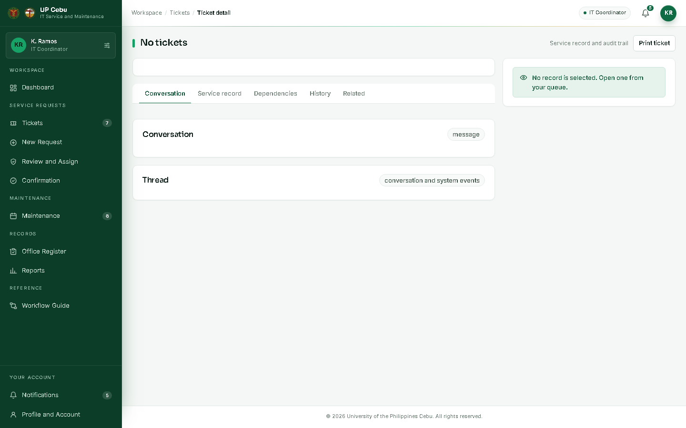

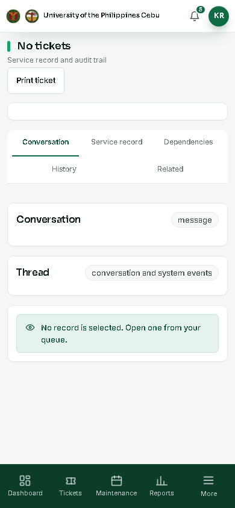

#### Maintenance

Schedules, generated jobs, pause and resume, and the next due date.


#### Confirmation and Closure

Reminders, authorized closure, recurrence and the maintenance visit closure.


#### Office Register

The central register of every ticket and job across all offices.


#### Reports

Cross-office metrics, definitions and the eight reports.


#### Notifications

Your inbox, with the read state per user.


#### Profile

Contact details and preferences.


#### Workflow Guide

The documented process for all four lanes.


#### Roles and Access

The role and route reference.


## 7. System Administrator

You administer the data the workflow depends on: people, offices, the asset
register, reference data and settings. You read the audit trail. You do not
operate the workflow: the dashboard, ticket, job, schedule, report and export
routes are not part of this lane and the backend refuses them.

Your screens:

| Screen | Address | What it is for |
|---|---|---|
| Accounts | `mgmt-users.html` | People, role, office and active state |
| Offices | `mgmt-offices.html` | Office records, codes, contacts and active state |
| Assets | `mgmt-assets.html` | The unit register: number, name, category, holding office, location |
| Settings | `mgmt-settings.html` | Categories, sources, priorities, frequencies, reminders, working week, closure roles |
| Audit Log | `mgmt-audit.html` | The append-only who did what, when history |
| Notifications | `mgmt-notifications.html` | Your inbox |
| Profile | `mgmt-profile.html` | Contact details and preferences |
| Workflow Guide | `mgmt-flow.html` | The documented process |
| Roles and Access | `mgmt-roles.html` | The role and route reference |

### 7.1 Accounts

Create or edit a person, set the role and office, and set the active state.
Renaming a person cascades to every record that names them. An account with no
provisioned role cannot enter the system.

### 7.2 Offices

Maintain the office record, its code and its contacts. Renaming an office
cascades to every record that names it, including the assets it holds.

### 7.3 Assets

Register a unit with its number, name, category, holding office and location.
A number fits `AA-AA-00` and can be registered once. Retiring keeps the record
so an older ticket still resolves to the same unit. Intake offers the
registered numbers as suggestions.

### 7.4 Settings and reference data

Settings carries the reminder clock and its interval, the working week, the
closed dates, the service level window, the approval categories, the priority
matrix and the authorized closure roles. Reference rows cover categories,
sources, priorities and maintenance frequencies.

The configured role actions may only narrow the shipped permission map, never
widen it. An administrator cannot grant a role a move the map does not allow.

### 7.5 Audit log

The audit log records who did what, when. It is append-only: no client can
edit or delete an event. Filter by actor, subject or event, and export the
filtered list to CSV.

### Your screens

#### Accounts

People, role, office and active state.


#### Offices

Office records, codes, contacts and active state.


#### Assets

The unit register.


#### Settings

Reference data and operational settings.


#### Audit Log

The append-only history.


#### Notifications

Your inbox.


#### Profile

Contact details and preferences.


#### Workflow Guide

The documented process for all four lanes.


#### Roles and Access

The role and route reference.


## 8. Shared screens and entry points

These screens appear in every lane, or in front of it.

### Workflow Guide

The swimlane diagram rebuilt from the specification, with every Yes and No
branch and a node-by-node coverage proof. Use it when you need to know which
lane owns the next step. It is also reachable at `flow.html`.

### Roles and Access

The four roles, what each may do, and the route permission reference. The page
stays reachable for every signed-in role at `roles.html`, but it is a reference
page and appears in no sidebar or tab bar.

### Notifications

The full inbox. The bell in the top bar shows the two-line preview; this page
holds every notification addressed to you. Read state is per user, and mark
all read clears the bell for you only.

### Profile

Contact details, the password panel, and appearance and session preferences.

### Entry points

| Screen | Address | What it is for |
|---|---|---|
| Sign in | `login.html` | UPMail sign-in and the demo accounts |
| Offline | `offline.html` | The offline fallback for an installed copy |
| Not found | `404.html` | The not-found page |


## 9. Rules that protect the record

* Every read and write is scoped to the signed-in role and office. An office
  user sees its own offices and its own requests; a technician sees assigned
  work; the coordinator sees all offices; the administrator sees no
  operational record.
* Internal notes are never delivered to an office session, and office users
  never see internal cost details or another office's data.
* The audit trail is append-only. It cannot be edited or deleted by any
  client.
* A Closed or Cancelled record is never edited. A recurrence creates a new
  linked ticket.
* Attachments are validated on the trusted layer: jpg, png, webp, pdf, docx,
  xlsx, csv or txt, at most 10 MB per file and 10 files per upload.
* A ticket cannot become Resolved without a passed test, and a maintenance job
  cannot become Successful without a complete checklist.
* The trusted backend refuses an action even when the interface is bypassed.
  Hiding a control is an additional layer, never the only one.

## 10. When the system says no

The refusal appears as a toast and the record does not change.

| What you tried | Why it was refused | What to do |
|---|---|---|
| Move a status the workflow does not allow | The transition is not in the map | Follow the next action the status names |
| Use a screen from another lane | The role does not hold that page | Open your own equivalent page |
| Act on a ticket or job assigned to another technician | The record is not yours | Ask the coordinator to reassign it |
| Answer the office decision as the coordinator | The office decides | Send a reminder or use authorized closure |
| Edit a Closed or Cancelled record | Terminal records are retained | Create a linked recurrence |
| Change or delete an audit event | The audit trail is append-only | Record a new event instead |
| Call an action outside your role | The permission map does not list it | Ask the role that owns the step |

## 11. The screen atlas and Figma

### How the captures were made

`python tools/shots.py` drives the installed Chrome over the DevTools
protocol with no extra dependency. Every capture loads the page with
`?demo=1`, which rebuilds the canonical seed, freezes the clock and disables
the random intake simulation, so the frames are deterministic and identical
on every run.

The atlas uses two viewports: desktop at 1440 by 900 and phone at 390 by 844.
Each screen is captured twice, once as the design canvas and once as the full
scroll height. The frames are at 1x device scale.

The default scope is the atlas: 48 screens made of the 45 role-named lane pages
and the three shared entry screens (`login.html`, `404.html`, `offline.html`).
The development Gallery at `index.html` is not a product screen and is not
captured. The `--figma` preset captures the 48 screens at desktop and phone in
both modes and then rewrites the manifest and the board:

```
python tools/shots.py --figma
```

To recapture one screen while checking a change:

```
python tools/shots.py --only or-dashboard.html --viewports desktop mobile --both
```

The exported frames sit in `shots/`, and the review gallery is
`shots/index.html`. The frames are generated, but they are committed to the
repository as the visual archive; the folder is ignored by default, so new
frames are force-added.

### Import into Figma

Figma imports PNG files as image layers inside frames, so no prototyping
connectors are needed. The frames are a visual archive, not a clickable
prototype.

1. Open `shots/figma-manifest.csv`. It lists one row per frame, with the Figma
   page, the frame name, the file, the viewport, the pixel size and the source
   page.
2. In Figma, create one page per lane: Shared, Office Requester, IT
   Technician, IT Coordinator, System Administrator.
3. Drag the PNGs for a lane onto its Figma page. Name each frame from the
   `frame_name` column. Rename the layer, not the image inside it.
4. Place the desktop frames in workflow order and the phone frames beside
   them. `shots/figma-board.html` is the same layout as a local contact sheet
   if you want to check the order before importing.

The manifest carries both the design canvas and the full-page frame. Import
the full-page frames for the archive, or the canvas frames when you need a
frame at a known device size. The `frame_mode` column says which is which.

What this does not give you: editable layers, auto layout or a `.fig` file.
The frames are flat images. If you need editable Figma layers, import the
served pages with the html.to.design plugin and point it at the running app
(for example `http://127.0.0.1:8787/or-dashboard.html`). That route needs the
server running and a plugin, and some components still flatten. The PNG route
is fast, offline and exact.

### The printable screen book

`python tools/screen_book.py` writes `shots/screen-book.pdf`, an A4 landscape
book with a cover, a contents page and one page per product screen. The
development Gallery at `index.html` is not a product screen, is not captured in
the atlas and is left out of the book. Each page carries the lane and screen
title, what the screen is, what it is for, numbered steps for how to use it,
the desktop and phone design canvases, the Figma frame names, the full-page
archive names and the source URL.

The three explanations come from `docs/SCREEN_GUIDE.md`, one section per source
page, so the book and the spoken walkthrough cannot drift. The generator
refuses to write the PDF when a screen is missing its what, what for, or at
least two how-to-use steps.

The book prints the design canvases rather than the full-page frames because
the workflow guide is tens of thousands of pixels tall. The full-page PNGs stay
in `shots/` and the manifest lists them. The PDF is for reading, printing and
sharing; import the PNGs into Figma, because a PDF does not become editable
layers.

### Regenerate after a change

```
python tools/shots.py --figma
python tools/screen_book.py
```

The first command recaptures every lane page plus the three shared entry
screens at desktop and phone in both modes, and rewrites
`shots/figma-manifest.csv` and `shots/figma-board.html`. The second rebuilds the
50-page PDF from the manifest and `docs/SCREEN_GUIDE.md`. To rewrite only the
manifest and the board, run `python tools/figma_manifest.py`.

## 12. Where the rules live

| Rule | Source |
|---|---|
| Which role may open which page and call which action | `permissions.json` |
| Which status may move to which | `permissions.json`, transition map |
| The required fields per action | `server/engine.py`, mirrored in `js/flow.js` |
| The status labels | `server/engine.py`, `_LABELS` |
| The role matrix and data scope | `docs/ROLE_MATRIX.md` |
| The operation catalogue | `docs/OPERATIONS.md` |
| The design tokens | `docs/THEME_SNAPSHOT.md` |
